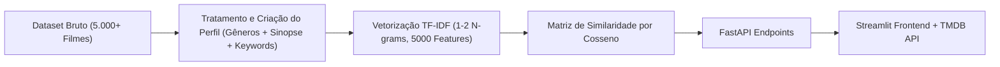

# 🍿 CineMatch Recommendations

<p align="center">
  
  
  
  
  
  
</p>

> **CineMatch Recommendations** é um sistema inteligente de recomendação de filmes baseado em **Processamento de Linguagem Natural (NLP)** e **Filtragem Baseada em Conteúdo (Content-Based Filtering)**. Utilizando **TF-IDF** e **Similaridade por Cosseno**, o motor correlaciona gêneros, sinopses e palavras-chave de mais de **5.000 títulos**, apresentados em uma interface moderna e cinematográfica no Streamlit com integração em tempo real à **API do TMDB**.

---

## 🌐 Demonstração Online

Experimente a aplicação diretamente no seu navegador:

👉 **[Acessar CineMatch no Streamlit Cloud](https://recomendacaofilmes.streamlit.app/)**

---

## ✨ Funcionalidades Principais

- 🔍 **Busca Inteligente & Autocomplete:** Sugestões instantâneas a partir de 2 letras digitadas.
- 📌 **Fixação Dinâmica de Títulos:** Fixe qualquer sugestão ou filme buscado para explorar recomendações automáticas com um clique.
- 🎲 **Modo "Surpreenda-me!":** Sorteio de filmes aleatórios do catálogo para quando bater a indecisão.
- 🎬 **Cards Cinematográficos com TMDB:**
  - Pôsteres oficiais em alta resolução (com fallback offline em SVG).
  - Ano de lançamento (`📅 2014`).
  - Avaliação oficial dos usuários (`⭐ 8.4/10`).
  - Sinopse completa traduzida para o português.
- 📊 **Medidor Visual de Afinidade:** Barra de progresso com gradiente e score exato de similaridade cosseno.
- 📑 **Navegação com Paginação:** Explore os 20 filmes mais similares de forma organizada (5 por página).
- 🎨 **Interface Dark Mode Premium:** Tipografia moderna (*Plus Jakarta Sans*), micro-interações ao passar o mouse e design responsivo.

---

## 🧠 Como Funciona o Motor de Recomendação



### 1. Perfil Textual Consolidado
Cada obra recebe uma assinatura textual combinando seus metadados essenciais:
```python
df['perfil'] = df['genres'] + ' ' + df['overview'] + ' ' + df['keywords']
```

### 2. Vetorização com TF-IDF
O texto consolidado é convertido em vetores numéricos ponderados pela frequência do termo no documento e no corpus inteiro:
```python
vectorizador = TfidfVectorizer(
    stop_words='english',
    max_features=5000,
    ngram_range=(1, 2)
)
tfidf_matrix = vectorizador.fit_transform(df['perfil'])
```

### 3. Similaridade por Cosseno
A proximidade semântica entre os filmes é determinada pelo cálculo do ângulo entre seus vetores:
$$\text{Similaridade}(\vec{u}, \vec{v}) = \frac{\vec{u} \cdot \vec{v}}{\|\vec{u}\| \|\vec{v}\|}$$

Os títulos com maior proximidade são ordenados decrescentemente, retornando o Top 20 mais recomendados.

---

## 🛠️ Tecnologias Utilizadas

| Tecnologia | Finalidade |
|---|---|
| **Python 3.13+** | Linguagem base de computação e dados |
| **FastAPI** | Backend de alta performance com endpoints REST assíncronos |
| **Uvicorn** | Servidor ASGI para hospedar a API |
| **Streamlit** | Interface interativa com componentes visuais customizados |
| **Scikit-Learn** | Vetorizador `TfidfVectorizer` e matriz `cosine_similarity` |
| **Pandas** | Carga, limpeza e estruturação dos dados tabulares |
| **TMDB API** | Enriquecimento com pôsteres, sinopses e notas dos filmes |
| **Requests** | Comunicação HTTP cliente-servidor |

---

## 📂 Estrutura do Projeto

```
sistema_recomendacao/
├── dataset/
│   └── movies.csv                 # Dataset TMDb com +5.000 produções
├── src/
│   └── sistema_recomendacao/
│       ├── __init__.py
│       ├── api.py                 # Rotas FastAPI (/recomendacoes, /sugestoes, /aleatorio)
│       ├── app.py                 # Interface Streamlit (CineMatch Recommendations)
│       ├── main.py                # Pipeline de Machine Learning e integração TMDB
│       └── notebook.ipynb         # Prototipagem e análise exploratória de dados
├── tests/
│   └── __init__.py
├── .gitignore
├── pyproject.toml                 # Gerenciamento de dependências Poetry
├── requirements.txt               # Dependências para deployment
└── README.md                      # Documentação completa do projeto
```

---

## 🚀 Como Executar Localmente

### Pré-requisitos
- **Python 3.13+** instalado.
- Chave de API gratuita do [The Movie Database (TMDB)](https://www.themoviedb.org/).

### 1. Clonar o Repositório
```bash
git clone https://github.com/seu-usuario/sistema_recomendacao.git
cd sistema_recomendacao
```

### 2. Criar e Ativar o Ambiente Virtual
**No Windows:**
```bash
python -m venv .venv
.venv\Scripts\activate
```

**No Linux / macOS:**
```bash
python3 -m venv .venv
source .venv/bin/activate
```

### 3. Instalar as Dependências
Utilizando o `pip`:
```bash
pip install -r requirements.txt
```
*(Ou, se preferir Poetry: `poetry install`)*

### 4. Configurar as Variáveis de Ambiente
Crie um arquivo `.env` na raiz do projeto com as seguintes variáveis:
```env
API_URL=http://127.0.0.1:8000
API_KEY_TMD=sua_chave_tmdb_aqui
```

### 5. Iniciar a API (FastAPI)
Em um terminal:
```bash
uvicorn src.sistema_recomendacao.api:app --reload
```
A API estará acessível em: `http://127.0.0.1:8000` (documentação interativa em `/docs`).

### 6. Iniciar a Interface (Streamlit)
Em um segundo terminal (com o ambiente virtual ativo):
```bash
streamlit run src/sistema_recomendacao/app.py
```
O navegador abrirá automaticamente em `http://localhost:8501`.

---

## 🔌 Endpoints da API

### `GET /recomendacoes`
Retorna a lista dos 20 filmes mais similares ao título informado.
- **Parâmetro:** `filme` (string)
- **Exemplo de Resposta:**
```json
{
  "base": "The Avengers",
  "recomendacoes": [
    {
      "base": "The Avengers",
      "titulo": "Avengers: Age of Ultron",
      "score": 0.52
    },
    {
      "base": "The Avengers",
      "titulo": "Iron Man 2",
      "score": 0.40
    }
  ]
}
```

### `GET /sugestoes`
Busca títulos no catálogo para autocompletar conforme o usuário digita.
- **Parâmetro:** `filme` (string)
- **Exemplo de Resposta:** `["The Avengers", "Avengers: Age of Ultron"]`

### `GET /aleatorio`
Sorteia um título aleatório cadastrado no dataset.
- **Exemplo de Resposta:**
```json
{
  "titulo": "Interstellar"
}
```

---

## 📊 Informações do Dataset

O catálogo foi extraído do dataset TMDB 5000 Movies, abrangendo:
- `original_title`: Título original em inglês.
- `genres`: Categorias/gêneros da obra.
- `overview`: Resumo do enredo.
- `keywords`: Termos-chave e conceitos da trama.
- `cast` & `director`: Atores principais e direção.
- `release_date` & `runtime`: Data de estreia e tempo de exibição.

---

## 👨‍💻 Autor

Desenvolvido por **Cláudio Carvalho**.  
Entre em contato: [claudio.carvalhogt@hotmail.com](mailto:claudio.carvalhogt@hotmail.com)

---

## 📄 Licença

Distribuído sob a licença **MIT**. Consulte o arquivo [LICENSE](LICENSE) para obter mais informações.
